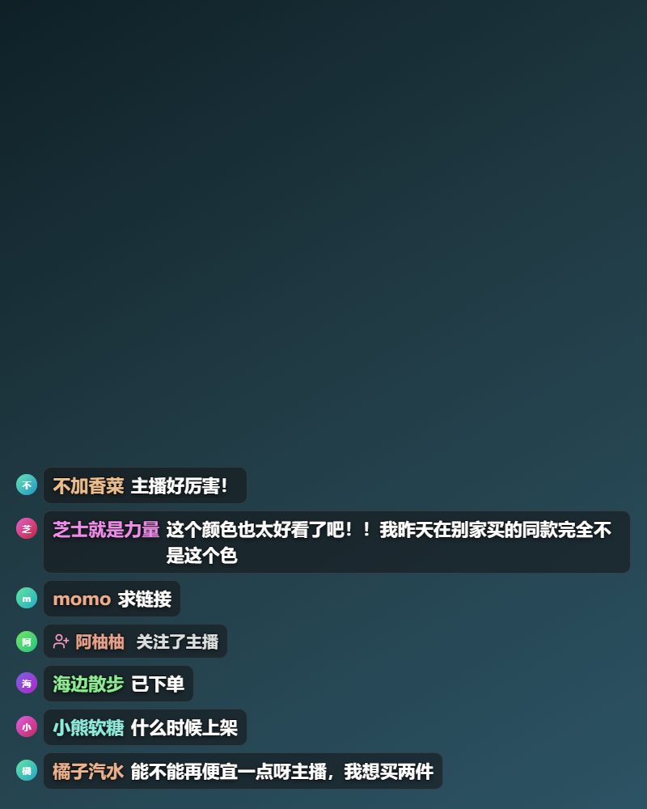
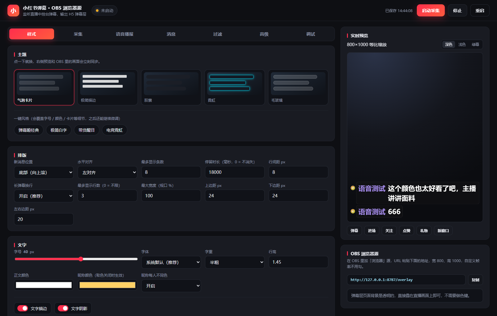

# 小红书直播弹幕 · OBS 浏览器源

把小红书直播间的**弹幕 / 进场 / 关注 / 点赞**实时渲染成一层透明 H5 弹幕层，直接在 OBS 里当「浏览器源」叠加到画面左下角 —— 用法和 B 站「弹幕姬」的 H5 弹幕层一样。

弹幕不是靠截图识别，也不是破解接口：本地起一个服务，**接管你自己的小红书直播助手**（或用一个真实的 Chrome 窗口打开中控台），旁听它本来就在收的弹幕 WebSocket，再把消息转发给 OBS 里的弹幕层页面。签名、token、设备指纹全部由真实客户端完成，所以不会因为平台改签名而失效。



> 截图都是本地模拟数据（`npm run mock`）的渲染效果，按 OBS 浏览器源 800×1000 的尺寸截的。

---

## 界面预览



左边调样式，右边是 800×1000 等比缩放的实时预览，改完立刻推到 OBS 里的弹幕层。

其余四套主题（极简描边 / 胶囊 / 霓虹 / 玻璃）和长弹幕换行效果见 [docs/screenshots/](docs/screenshots/)。

---

## 能做什么

- **事件**：文字评论、进场、关注、点赞（礼物已支持解析，默认不显示）
- **五种主题**：气泡卡片 `bubble`、极简描边 `minimal`、胶囊 `capsule`、霓虹 `neon`、玻璃 `glass`
- **可调样式**：字号 / 字重 / 行高 / 正文与昵称颜色 / 昵称随机取色 / 文字描边 / 阴影 / 卡片圆角与模糊 / 头像开关 / 行间距 / 最大宽度 / 边距
- **行为**：最多显示条数、停留时长、新消息在顶部还是底部、左中右对齐、入场动画、关键词高亮、屏蔽词、屏蔽用户、长度限制、防刷屏限速
- **网页控制台**：一键启动、登录引导、实时预览、样式所见即所得、原始帧调试
- **改样式即时生效**：控制台改完直接推送到 OBS 的弹幕层，不用重新添加浏览器源

---

## 环境要求

| 项目 | 说明 |
| --- | --- |
| Node.js | ≥ 18（开发时用的是 v20） |
| 浏览器 | 本机装有 **Chrome** 或 **Edge**（自动探测；也可用环境变量 `CHROME_PATH` 指定） |
| 系统 | Windows / macOS 均可 |
| 账号 | 你自己的小红书账号，并且**正在开播**（弹幕只在自己的直播间里有） |
| 可选 | 「小红书直播助手」（方式 A 用）；或能登录方舟 / 蒲公英的中控台账号（方式 B 用） |

---

## 快速开始

```bash
cd xhs-danmaku
npm install
npm start
```

启动后会自动在浏览器里打开控制台（<http://127.0.0.1:8787/admin>），不用自己找端口。
不想自动开浏览器就加 `--no-open`。

Windows 上也可以直接双击 **`start.cmd`**：会自动检查依赖、启动服务、打开控制台，关掉黑窗口即停止。

只想先看效果、不想登录小红书：

```bash
npm run mock
```

---

## 两种拿弹幕的方式

插件不破解签名，只**旁听**真实客户端本来就在收的弹幕长连接。两种接法走的是同一条通道、同一份解析代码：

| 方式 | 适合谁 | 前提 | 数据源 |
| --- | --- | --- | --- |
| **A. 接管「小红书直播助手」**（默认，推荐） | 普通用户，用直播助手开播 | 装了直播助手；**启动前把它完全退出** | `app` |
| B. 开一个真实 Chrome 看网页 | 商家 / 达人，有中控台权限 | 能登录方舟或蒲公英后台 | `xhs` |

两种方式拿到的字段完全一样（弹幕 / 进场 / 关注 / 点赞），样式与 OBS 那边没有任何区别。

### 方式 A：接管「小红书直播助手」

直播助手本身是个 Electron 应用，里面用的就是网页版那条 `apppush` 弹幕长连接。插件的做法是：用它自带的调试端口把它拉起来，再从调试协议里把收到的 WebSocket 帧读出来——**不用账号密码，也不用再扫一次码**（用的是 App 里已登录的账号）。

1. 先把「小红书直播助手」**完全退出**：右键托盘图标 → 退出，并确认任务管理器里没有 `xhs-live-helper.exe`。
   （已经在运行的 App 没有调试端口，插件连不上去，会提示你先退出。）
2. 控制台右上角点 **启动采集**。插件会自己找到 App、带上调试端口启动它，并接上弹幕通道。
3. 在 App 里登录、开播。状态变成「接收中」后，预览区和 OBS 就开始滚弹幕了。
4. 直播结束后关掉 OBS 源、点 **停止** 即可；App 还是你自己的 App，正常用。

> 自动探测的位置：`D:\Program Files\xhs-live-helper\<版本>\xhs-live-helper.exe` 之类的常见目录。
> 装在奇怪的地方就在「采集」页把路径填进 **直播助手位置**。
> 调试端口默认 `9222`，被别的程序占了就换一个（比如 `9333`）。
>
> **拉不起来怎么办。** 直播助手的 exe 要求管理员权限，插件用的是「先直接启动，失败就交给系统的提权通道」这套办法：
> 正常会静默提权（或弹一个 UAC 框，点「是」）。如果你的系统把提权拦了，双击项目里的
> `start-helper-debug.cmd`——它会以调试模式打开直播助手（同样可能需要一次 UAC），
> 然后回到控制台点 **启动采集**，插件会自动接上这个调试端口。
> 这个脚本也可以带参数换端口：`start-helper-debug.cmd 9333`。

### 方式 B：网页中控台

1. 控制台「采集」页把数据源切成 **网页中控台**，右上角点 **启动采集**。
2. 会自动弹出一个 Chrome 窗口并打开直播中控台（默认是**蒲公英**：`https://pgy.xiaohongshu.com/commerce/redlive/live_center_control`）。
3. 如果没登录，小红书会把页面跳到扫码登录页 —— **就在这个弹出的窗口里扫码登录**（扫码用手机小红书 App）。
4. 登录成功后会自动跳回中控台，控制台状态从「需要登录」变成「接收中」。
5. 手机上开播（或在网页端进入直播中控），弹幕就会出现在控制台的预览区和 OBS 里。

#### 中控台地址选哪个

小红书有两套后台，登错地方就会看到「招商 / 入驻」页面，那是正常的——不是插件坏了：

| 账号类型 | 中控台 | 地址 |
| --- | --- | --- |
| 达人 / 个人创作者 | **蒲公英**（默认） | `https://pgy.xiaohongshu.com/commerce/redlive/live_center_control` |
| 商家 / 店铺 | 方舟 | `https://ark.xiaohongshu.com/live_center_control` |

控制台「采集」页的下拉框可以一键切换。**还有第三条路**：如果两个后台你都没权限（普通用户就是这样），那就选「自定义」，把**你自己直播间**的网页地址填进去——开播后那个页面里就有弹幕。

插件认的不是域名，而是页面里的弹幕 WebSocket 通道（`apppush` / `rwp`）。所以你也可以启动后在弹出的浏览器里自己点来点去——**任何新标签页都会被自动挂上监听**，点到能看见弹幕的页面就会开始收。

> 登录态保存在 `data/browser-profile` 这个独立的浏览器配置目录里，和你的日常 Chrome 互不影响；下次启动不用再扫码。
> 掉了登录态就在控制台点 **打开登录页** 重新扫一次。

---

## 添加到 OBS

1. 场景里点 `+` → **浏览器** → 命名为「小红书弹幕」。
2. URL 填：

   ```
   http://127.0.0.1:8787/overlay
   ```

3. 宽度 `800`、高度 `1000`（默认样式就是按这个尺寸调的；想铺满 1920×1080 就把宽高填 `1920` / `1080`，再把「字号」和「边距」调大一倍左右）。
4. 「自定义 CSS」留空；**不要**勾选「关闭源时关闭页面」（勾了切场景后弹幕会断，要重新加载）。
5. 页面背景是完全透明的，直接叠在画面上即可；位置和大小按需拖动。

同一个地址也可以直接丢进浏览器新标签页里看效果。

---

## 用「小红书直播助手」推流的情况

推流方式完全不影响弹幕采集：不管你是 OBS 直接推，还是用直播助手推流，弹幕都来自**同一个 `apppush` 长连接**。区别只在于插件从哪儿旁听它——见 [两种拿弹幕的方式](#两种拿弹幕的方式)：

- 普通用户：选数据源 `app`，插件自己把直播助手拉起来，**不用登录网页后台，也不用扫码**；
- 有中控台权限：选数据源 `xhs`，用弹出的 Chrome 登录方舟 / 蒲公英，第一次要扫一次码，之后登录态存在 `data/browser-profile`。

如果你的直播助手支持「屏幕 / 窗口捕获」，也可以不用 OBS：把 <http://127.0.0.1:8787/overlay> 在浏览器里全屏打开（透明背景需要 OBS 才透明，普通窗口捕获会有底色），作为画面源采集进去。

---

## 控制台一览

控制台是一个网页（<http://127.0.0.1:8787/admin>），左边六个标签页，右上角常驻「实时预览」。

| 标签页 | 里面有什么 |
| --- | --- |
| **样式** | 主题画廊（5 套，点击即换）+ 一键风格（弹幕姬经典 / 极简白字 / 带货醒目 / 电竞霓虹）+ 排版 / 文字 / 卡片头像 / 动画 / 关键词高亮 |
| **采集** | 数据源（直播助手 / 网页中控台 / 本地模拟）、调试端口或中控台地址；启动 / 停止 / 重启、打开登录页、把窗口置前；状态与计数 |
| **消息** | 显示哪几类消息（弹幕 / 进场 / 关注 / 点赞 / 礼物）、事件文案、连接状态角标 |
| **过滤** | 屏蔽关键词、屏蔽用户、字数上下限、同一用户冷却、全局每秒上限 |
| **高级** | 自定义 CSS、立即保存、导出 / 导入配置、恢复默认 |
| **调试** | 原始帧面板：最近收到的 WS 帧、解析条数、未知 type，排错用 |

几个顺手的点：

- **主题 = 一套预设**：点主题卡片会同时把卡片背景 / 圆角 / 文字色 / 头像这些一起写进配置，所以换完主题再手动微调（比如把胶囊改成红底、换个圆角）都能生效，不会被主题样式吃掉。主题本身只再额外负责装饰（霓虹外发光、毛玻璃竖条、极简描边阴影）。
- **改动即时生效**：任何样式改完 260ms 后自动保存并推送到 OBS，不用重新添加源；右上角显示「已保存 时:分:秒」。
- **实时预览**：右栏就是 800×1000（和 OBS 浏览器源同尺寸）等比缩小的弹幕层本体，点下面的按钮可以注入弹幕 / 进场 / 关注 / 点赞 / 礼物测试事件；背景可切深色 / 浅色 / 绿幕，方便看描边和透明效果。
- **新窗口预览**：想把弹幕层放到另一个显示器上边调边看，点「新窗口」。
- **配置备份**：`高级 → 导出配置` 存成 JSON，换电脑或想留着调好的样式时 `导入配置` 回来。

---

## 配置项

配置文件：`data/config.json`（删掉就恢复默认）。

### `source` 采集

| 键 | 默认 | 说明 |
| --- | --- | --- |
| `mode` | `app` | `app` 接管直播助手 / `xhs` 真实浏览器中控台 / `mock` 本地假数据 |
| `appPath` | `''` | 直播助手 exe 路径，留空自动探测 |
| `debugPort` | `9222` | 接管直播助手时用的本地调试端口 |
| `headless` | `false` | 仅 `xhs` 用。是否无头运行。**建议保持 false**：要扫码登录，而且无头容易被风控 |
| `consoleUrl` | 中控台地址 | 打开的目标页面 |
| `loginUrl` | 登录页 | 「打开登录页」按钮跳转的地址 |
| `captureHttp` | `false` | 除 WS 外，是否额外抓 HTTP 响应里的消息（排错用，平时关掉） |
| `autoStart` | `false` | 启动服务时是否自动开始采集 |
| `autoReconnect` | `true` | 浏览器窗口被关掉后是否 4 秒后自动重连 |

### `overlay` 弹幕层

| 键 | 默认 | 说明 |
| --- | --- | --- |
| `theme` | `bubble` | `bubble` / `minimal` / `capsule` / `neon` / `glass` |
| `newestAt` | `bottom` | 新消息在底部（`bottom`）还是顶部（`top`） |
| `align` | `left` | `left` / `center` / `right` |
| `maxItems` | `8` | 同时最多显示几条 |
| `ttlMs` | `18000` | 单条停留毫秒数，`0` = 不自动消失 |
| `gap` | `8` | 行间距 px |
| `maxWidthPct` | `100` | 单条最大宽度（视口百分比） |
| `wrap` | `true` | 长弹幕自动换行；关掉则一行到底、超出用省略号 |
| `maxLines` | `3` | 换行后最多显示几行，`0` = 不限 |
| `paddingTop/Bottom/Side` | `24` / `24` / `20` | 四周留白 px |
| `fontSize` | `22` | 字号 px（按 800×1000 的源调的，1920×1080 建议 40+） |
| `fontWeight` | `600` | 字重 |
| `lineHeight` | `1.45` | 行高 |
| `color` | `#ffffff` | 正文颜色 |
| `nicknameColor` | `#ffd166` | 昵称颜色（`nicknameColorize` 开启时被随机色覆盖） |
| `nicknameColorize` | `true` | 按昵称 hash 取色，每人不同色 |
| `textStroke` / `textStrokeWidth` / `textStrokeColor` | `true` / `1.5` / `rgba(0,0,0,.85)` | 文字描边，浅色背景下保证可读 |
| `shadow` | `true` | 文字投影 |
| `card.*` | — | 卡片背景色 / 圆角 / 内边距 / 模糊 / 边框 |
| `avatar.show` / `avatar.size` | `true` / `26` | 头像开关与尺寸（加载失败自动退化成昵称首字） |
| `show.*` | 礼物 `false`，其余 `true` | 各类消息是否显示 |
| `text.*` | `来了` / `关注了主播` / `点了赞` / `送出` | 事件行文案 |
| `highlight.keywords` | `[]` | 关键词高亮列表 |
| `animation.in` | `slide` | `slide` / `fade` / `pop` / `none` |
| `filter.*` | — | 屏蔽词、屏蔽用户、长度限制、同用户冷却、每秒限速 |
| `customCss` | `''` | 追加到弹幕层的自定义 CSS |
| `showStatus` | `false` | 右下角调试状态角标，**推流前记得关** |

---

## 支持的消息类型

小红书的中控台和观众端共用同一套 `customData.type`：

| `type` | 事件 | 关键字段 |
| --- | --- | --- |
| `text` / `text_message` | 弹幕 | `desc`、`profile.{nickname,avatar,user_id,role}` |
| `audience_join_v2` | 进场 | `profile.*` |
| `praise`（含 `light` / `combo_praise` / `like*` / `thumb_up*` 等变体） | 点赞 | `like_user_info`、`like_count` / `like_num` / `count` |
| `follow_emcee`（含 `follow*` / `subscribe*` / `attention` 等别名） | 关注 | `follow_user_info` |
| `gift_comment` | 礼物 | `send_user_info`、`base_gift_info.{name,coins}`、`gift_action_info.count` |
| `share` / `refresh` / `letter_refresh` / `live_banner_resource` / `goods_rank_entrance_im` / `fansgroup_join_room_effect` | 忽略 | 平台噪声（分享、房间统计、榜单入口等） |

解析时对用户字段做了多重兜底（`profile` / `user` / `like_user_info` / `follow_user_info` / `send_user_info`），遇到**没见过的 type** 不会崩，而是计入控制台的「未知类型」计数并在原始帧面板里留样。

---

## 常见问题

**点「启动采集」提示「直播助手正在运行，但不是调试模式」**
直播助手已经在跑了，而它启动时没带调试端口，插件连不上去。右键托盘图标**完全退出**它（任务管理器里确认没有 `xhs-live-helper.exe`），再点一次「启动采集」——插件会自动带上调试参数启动它。

**方式 A 提示找不到直播助手**
把安装目录里的 `xhs-live-helper.exe` 路径填进「采集 → 直播助手位置」。常见位置是 `D:\Program Files\xhs-live-helper\<版本号>\xhs-live-helper.exe`。

**状态一直停在「正在打开中控台」/ 浏览器里是招商、入驻页面**
这是方式 B 才会遇到的：中控台没登录，或**登错了后台**——`ark` 是商家（店铺）后台，普通个人账号进去只会看到「招商 / 入驻」。普通用户直接用方式 A（接管直播助手），或者把「中控台地址」切成**蒲公英**再点一次启动。点「打开登录页」会按当前中控台地址生成跳转参数，不会把你送回错的站点。实在不行就把能看到弹幕的页面地址填进「自定义」，或者启动后自己点进那个页面——插件会自动接上任何标签页。

**状态是「接收中」，但弹幕层没有内容**
- 必须真的在**直播中**（未开播时中控台没有弹幕通道）。
- 别把采集用的 Chrome 窗口最小化 —— 后台标签页的 WebSocket 会被浏览器节流，建议保持窗口可见或至少不最小化。
- 检查控制台的「已出弹幕」计数是否在涨：涨说明后端收到了，问题在渲染；不涨说明没收到，看原始帧面板。

**只看得到进场/点赞，看不到文字弹幕**
小红书的评论订阅依赖弹幕区真正挂载。窗口别用极小尺寸/无头模式，保持正常窗口大小即可。

**点赞事件没有昵称**
平台对 `praise` 类事件的 `profile` 常常是空的，昵称只能从 `desc` 里正则兜出来，兜不到时显示「观众」。这是平台数据本身的问题。

**端口 8787 被占用**
```bash
node src/index.js --port=8788
```
同时把 OBS 里的地址改成 `http://127.0.0.1:8788/overlay`。

**弹幕层显示「离线」角标**
弹幕层和服务器的 WS 断了，页面会自己按 500ms→8s 退避重连。确认 `npm start` 还在跑、端口没变。

**推流时出现了右下角小角标**
控制台关掉「显示连接状态」（`showStatus`）。

---

## 命令行

```bash
npm start                       # 正常启动（真实采集，需在控制台点启动）
npm run mock                    # 本地模拟数据，直接开跑
node src/index.js --mock        # 同上
node src/index.js --headless    # 无头浏览器（无法扫码，仅适合已登录过）
node src/index.js --port=8788   # 换端口
node src/index.js --auto-start  # 启动即开始采集
```

命令行参数只影响当次运行，不会主动写回 `config.json`。

> 小提示：`--mock` / `--port=` 只改内存里的配置。如果你用 `--mock` 起的服务，之后又在控制台改了任何设置（主题、字号……），控制台会把「当前这份配置」整体保存下来，于是 `mode: mock` 也会被一起存进去。下次想回到真实采集，把控制台的「数据源」切回「小红书」再点启动即可（或者删掉 `data/config.json` 重新开始）。

### HTTP / WebSocket 接口

| 方法 | 路径 | 说明 |
| --- | --- | --- |
| GET | `/` `/admin` | 控制台 |
| GET | `/overlay` | 弹幕层（OBS 用） |
| GET | `/api/health` | 健康检查 |
| GET/PUT | `/api/config` | 读写配置（PUT 会立即推送到弹幕层） |
| POST | `/api/config/reset` | 恢复默认配置 |
| GET | `/api/status` | 采集状态 |
| POST | `/api/start` `/api/stop` `/api/restart` | 启动 / 停止 / 重启采集 |
| POST | `/api/login` `/api/reload` `/api/focus` | 打开登录页 / 刷新中控台 / 置前窗口 |
| POST | `/api/test` | 注入一条测试事件（`{kind, text, name}`） |
| GET | `/api/raw` · POST `/api/raw/clear` | 原始帧日志 / 清空 |
| WS | `/ws` | 弹幕层与后台通信用（`hello` / `event` / `raw` / `source` / `config`） |

---

## 目录结构

```
xhs-danmaku/
├─ src/
│  ├─ index.js            # 入口：解析参数、起服务、优雅退出
│  ├─ server.js           # HTTP 静态服务 + API + WebSocket 广播
│  ├─ config.js           # 默认配置、深合并、原子读写
│  ├─ bus.js              # 事件总线：归一化、去重、过滤、限速、环形缓冲
│  ├─ sources/
│  │  ├─ index.js         # SourceManager：mock / xhs / app 切换、自动重连
│  │  ├─ frames.js        # 两条链路共用的帧解析（帧计数 → 解码 → 入总线）
│  │  ├─ zhushou.js       # 接管「小红书直播助手」：CDP 连接 + 旁听 WS（方式 A）
│  │  ├─ xhs.js           # 真实采集：启动 Chrome、打开中控台、旁听 WS（方式 B）
│  │  └─ mock.js          # 本地假数据源
│  └─ xhs/
│     └─ decode.js        # 三层解包：外层帧 → base64 → customData
├─ web/
│  ├─ overlay/            # OBS 弹幕层（透明页面）
│  ├─ admin/              # 控制台
│  └─ shared/themes.js    # 五套主题的默认观感（控制台和截图脚本共用一份）
├─ data/                  # 运行时生成：config.json、browser-profile/
└─ scripts/               # 开发用截图 / 布局调试脚本
```

---

## 工作原理

```
方式 A（默认）
┌──────────┐ CDP 连调试端口 ┌────────────────────────────────┐
│ 本服务    │ ────────────▶ │ 小红书直播助手（Electron 27）    │
│ (Node)   │ ◀──────────── │ WS: apppush-rws…/rwp           │
└────┬─────┘ Network 帧     └────────────────────────────────┘
     │
方式 B
┌──────────┐ 打开中控台      ┌──────────────────────────────┐
│ 本服务    │ ────────────▶ │ 真实 Chrome（独立 profile）    │
│ (Node)   │ ◀──────────── │ WS: apppush-rws…/rwp         │
└────┬─────┘ framereceived  └──────────────────────────────┘
     │ decode: 外层帧 → base64 → customData
     │ bus: 归一化 / 过滤 / 去重
     ▼
  WebSocket /ws  ──▶  OBS 浏览器源 http://127.0.0.1:8787/overlay
                 ──▶  控制台预览 / 原始帧面板
```

两条路最后都汇到 `src/sources/frames.js` 的 `consumeFrame()`，所以解析、去重、过滤、统计只有一份。

帧结构（实测）：

```
{ "v":1, "t":4, "m":"0ac…",
  "b": { "d": { "a":0, "biz":"room", "t":1712…,
        "b":[ { "d":"<base64>", "e":{}, "m":"1" } ] } } }

base64 解码 → { "command":1, "customData":"<json>", "roomId":…, "roomType":"LIVE", … }
customData 解析 → { "type":"text", "desc":"主播好美", "profile":{…} }
```

`t !== 4` 是空帧，`command !== 1` 不是业务消息，都会跳过。

---

## 开发 / 调试

```bash
npm run mock                         # 假数据铺满弹幕层
npm run shot                         # 截图弹幕层与控制台（需要本机 Chrome）
npm run shot:themes                  # 五种主题各截一张
npm run probe                        # 只跑采集链路，打印状态机进展
```

- 所有样式都走 CSS 变量（由 `web/overlay/overlay.js` 写在 `body` 的内联样式上，优先级最高，主题 CSS 不会覆盖用户设置）。
- 加新主题：在 `web/shared/themes.js` 里加一组默认观感 + 在 `web/overlay/overlay.css` 里加装饰规则 + 控制台 `index.html` 加一张主题卡。
- 遇到不认识的 `type`：控制台「原始帧」面板会留下原始 JSON 和未知类型计数，照着往 `src/xhs/decode.js` 的 `TYPE_MAP` 里加即可。

---

## 说明

- 只用于**自己直播**时给自己做弹幕展示，需要登录你自己的账号。
- 不保存账号密码，登录全程在真实浏览器窗口里完成；只把登录态留在本地 `data/browser-profile`。
- 所有数据只在本机内存和本机 `data/` 目录里流转，不上传任何第三方服务器。
- 请遵守小红书用户协议；因使用本工具导致的账号风控/封禁风险由使用者自行承担。

---

## 许可

[MIT](LICENSE) © 2026 Sky-senge

